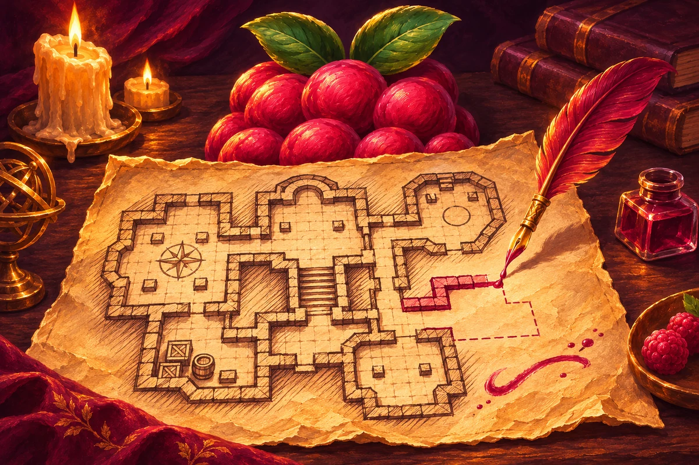

# MJl - Dungeon Sketch



Самостоятельный редактор подземелий для Foundry VTT 14. Dungeon Draw служил ориентиром по инструментам. Код редактора, оформление и графика написаны для Dungeon Sketch. Геометрические операции выполняет Clipper из поставки Foundry.

## Установка

Установите модуль через витрину MJl - Modules Hub или вставьте адрес манифеста в штатный установщик Foundry.

```text
https://raw.githubusercontent.com/MJl2517/MJl-Dungeon-Sketch/main/module.json
```

Включите модуль в управлении модулями мира Foundry 14. На сцене мастер выбирает категорию «Подземелье» в левой панели. Этажи доступны в разделе «Этажи», а генерация и стиль всего этажа открываются отдельными кнопками. Игрокам доступны опубликованные документы сцены.

## Необязательные интеграции

- **Socketlib 1.1.4+** передаёт запросы игроков к активному мастеру для открытия контейнеров, выдачи добычи и переключения света. Рисование, автосохранение, редактор контейнеров и переключатели света мастера доступны самостоятельно.
- **Хроники 1.3.6+** добавляют точки интереса со ссылкой на карточку локации и её галерею. Обычные заметки Foundry работают независимо.
- **Adventure Guys Fifthpendium** учитывается при выдаче свитков из контейнера, если модуль включён.

Hub, Pointcrawl, Dungeondraft Tile Browser и One Page Dungeon Importer могут работать в одном мире с Dungeon Sketch. Редактор использует собственную копию общей темы MJl.

## Рисование

В разделе «Точки интереса» выберите «Заметка Foundry» или «Локация Хроники» и нажмите на карте. Можно привязать журнал или страницу, выбрать существующую локацию Хроники или создать скрытую карточку для будущего арта. Двойной клик по отметке открывает запись. На штатном слое заметок Foundry можно перемещать и удалять отметки. Игроки видят их с учётом доступа к записи и тумана войны.

С версии 0.8.0 изменения сохраняются автоматически: примерно через 0,6 секунды после завершения действия или последней правки. Рисование, мебель, свет, стиль этажа, удаление, генерация, отмена и повтор становятся видны игрокам без кнопки «Применить». Пока идёт запись, можно продолжать работу: новые правки отправятся следом. Смена этажа и закрытие окна не отменяют очередь. Вверху показано состояние сохранения. Ctrl+S / Ctrl+Enter отправляет готовые правки сразу.

При ошибке модуль сохраняет черновик и до трёх раз автоматически повторяет запись с теми же ID. Затем остаётся кнопка «Повторить сохранение». Незавершённая публикация восстанавливается при следующем открытии редактора. Если появились новые правки во время записи, они остаются в черновике и сохраняются следующими. Пока есть несохранённые изменения, браузер предупреждает о закрытии/перезагрузке страницы. Не закрывайте вкладку принудительно до сообщения «Все изменения сохранены».

Снимки карт и рисунки ловушек сохраняются в `Data/worlds/<мир>/mjl-dungeon-sketch/`. При входе активного мастера модуль переносит старые карты из корня через обычное автосохранение. На локальном Windows-хосте кнопка «Подземелье → Инструменты → Очистить файлы карт» запускает проверку и запрашивает подтверждение перед удалением. Для кнопки зарегистрируйте схему `mjl-dungeon-sketch-cleanup-<мир>` за `wscript.exe host/launch-cleanup.vbs <node.exe> <папка мира> <Foundry/resources/app>` с абсолютными путями в кавычках. Команда регистрации задаёт мир и пути, не передавая URL. Для настольного клиента создайте `host/launch-cleanup-<мир>.svg` из `host/launch-cleanup.svg`, заменив `__WORLD__` на ID мира. На других хостах запустите `node host/clean-map-assets.cjs <папка мира> <Foundry/resources/app> --audit`. Режим `--apply` удаляет только файлы Dungeon Sketch старше 30 минут без ссылок в данных Foundry.

- Нажмите «Стены и проходы», чтобы открыть окно с инструментами. Окно перемещается за заголовок. Выберите прямоугольник, эллипс или кисть и проведите мышью по сцене. Для многоугольника поставьте вершины кликами и нажмите Enter. Escape отменяет незавершённый жест. Переключатель «Вырезать пол» вычитает фигуры из пола. Shift временно отключает привязку.
- Внутренние и невидимые стены, обычные и секретные двери и окна рисуются от начала до конца отрезка. Двери свободно ставятся в любом месте и под любым углом, без притягивания к стене. Привязка к сетке управляется отдельно через G / Shift. Если отрезок проёма лежит на стене, он разрезает её; при свободном размещении соседняя стена остаётся на своём месте. Невидимая стена блокирует движение и пропускает свет, обзор и звук. Окно использует штатный пресет Foundry с дистанцией обзора и света в две клетки и блокирует движение.
- «Стиль всего этажа» на левой панели открывает цвета и текстуры текущего этажа. Сохранение заменяет его основной стиль и прежние окрашенные области; Ctrl+Z отменяет изменение; обе правки сохраняются автоматически. В окне рисования «Стиль кисти» и «Настроить стиль» задают оформление для нанесения на отдельную область. Стили сохраняются отдельными копиями, поэтому настройка этажа не перекрашивает другие этажи. В окне доступны рисунки плитки, плит, брусчатки, досок и земли, а для стен — кладка, грубый камень и балки. Выберите цвета отдельно для пола и стен. Предпросмотр показывает результат до сохранения. Для своих файлов используйте пункт «Свой файл…».
- Во встроенном узоре «Квадратная плитка» один квадрат совпадает с одной клеткой сцены: при сетке 5 футов это плитка 5 × 5 футов. Масштаб следует размеру клетки в пикселях; сдвиг и отступы сцены учитываются. Узор начинается от общей сетки, поэтому не сбивается между комнатами и окрашенными областями. У остальных встроенных узоров сохранены отдельные камни, доски и штрихи; их масштаб также следует сетке. Кладка, плиты и доски имеют согласованные края повтора. Пользовательские файлы используют свой исходный размер.
- Свет ставится кликом. Лестница строится в два этапа: проведите первую ступень и отпустите мышь — это фиксирует её угол и ширину. Затем отведите курсор в сторону нужной длины. Смещение курсора к середине первой ступени сужает дальний край, за её концы — расширяет; ступени показываются в предпросмотре. Клик или Enter завершает лестницу, Esc / ПКМ отменяет незавершённое построение. Для точного сужения отключите сетку через G или удерживайте Shift. Числовой поворот не нужен. Ступени имеют непрозрачную подложку выбранного цвета и контрастные контуры, поэтому не сливаются с текстурой пола. «Только рисунок» позволяет рисовать ступени даже на сцене с одним этажом. Для перехода выберите этаж назначения: модуль создаст небольшой штатный Region у края, на который указывает стрелка. Жирная линия отмечает конечный край, пунктир — начало посадочной полосы. Полоса занимает до половины клетки или половины длины короткой лестницы. До неё токен остаётся на исходном этаже, в том числе в бою; затем штатный переход переносит тот же токен на этаж назначения. Дополнительные этажи не создаются. Это работает и для лестницы длиной в одну клетку. Переход доступен в той же позиции с обоих этажей. Лестницу редактируют с этажа, на котором её создали. Запрос повторяется только после выхода из зоны перехода и нового входа, в том числе после отказа.
- Ластик области удаляет пересекающие её стены, двери, свет и лестницы, а также вырезает оформление внутри области. Генератор заменяет черновик текущего этажа. Ctrl+Z и Ctrl+Y отменяют и повторяют действия.
- «PNG» скачивает изображение. «Сделать фоном» после подтверждения назначает изображение фоном текущего этажа. Пока карта хранится в фоне, последующие публикации обновляют этот фон. Очистка карты возвращает прежний фон, если после публикации его не меняли вручную.
- «Очистить этаж» после подтверждения сразу удаляет опубликованный рисунок, стены, двери, свет и переходы Dungeon Sketch на текущем этаже для всех участников. Ручные объекты, объекты других модулей и других этажей сохраняются. Очистка работает и для уже пустого рисунка с оставшимися стенами, а также отменяет незавершённую публикацию этого этажа. Если запись очистки прервалась, автосохранение продолжит её. «Отменить» возвращает прежний рисунок и автоматически публикует его снова.

## Этажи (0.9.0)

На левой панели откройте «Этажи». Здесь находятся маршевая лестница, приставная лестница, ступеньки и люк. Первые три строятся в два этапа: проведите первую сторону, затем задайте длину и сужение. У ступенек более редкие широкие проступи, у приставной лестницы — боковые направляющие и перекладины. Люк задаётся обычным перетаскиванием прямоугольника, в том числе в одну клетку. G / Shift управляют сеткой.

Выберите цвет нажатием на образец палитры, как у мебели; последний квадрат открывает свой цвет. Подложка полностью непрозрачна. Тёмные цвета получают светлый контур, светлые — тёмный. Чтобы изменить уже размещённый переход, выберите его указателем или нажмите ПКМ: появятся палитра и этаж назначения. Delete / «Удалить переход» и ластик удаляют его; отмена и повтор сохраняются автоматически.

Этаж назначения выбирается перед построением либо в настройках выбранного перехода. «Только рисунок» не создаёт перехода. У лестниц и ступенек зона смены этажа остаётся у направленного конечного края; у люка она занимает всю его площадь. Во всех случаях используется штатный Region/changeLevel с одним запросом на вход. Дополнительные этажи или актёры не создаются. Старые лестницы при первом открытии редактора получают бежевую непрозрачную подложку; координаты, ID и назначения сохраняются.

В «Стены и проходы» доступны четыре обычные двери: деревянная, решётчатая, металлическая и каменная. Они рисуются свободным отрезком; при совпадении с существующей стеной вырезают в ней проём. Закрытая решётчатая дверь пропускает обзор, свет и звук, но блокирует движение; металлическая и каменная блокируют их как обычная дверь. Все варианты используют штатные открывание, закрывание и замок Foundry. При повторной публикации с прежней геометрией сохраняются ID и состояние двери. D выбирает деревянную дверь, Shift+D — секретную; новые варианты выбираются кнопками. Старые двери сохраняют прежнее оформление.

## Настройка этажей (0.11.0)

Откройте «Подземелье» → «Этажи» → «Настроить этажи». Укажите число этажей, общую высоту от пола до пола и названия. Например, при высоте 10 ft пол первого этажа находится на 0 ft, второго — на 10 ft, третьего — на 20 ft. Отметка первого этажа позволяет начать с подвала или иной высоты. Все значения используют единицы сетки сцены. Модуль настраивает штатные Level; журналов и дополнительных актёров нет. Существующие ID этажей, чужие документы и HP существ сохраняются. Число этажей можно увеличивать; удаление существующих этажей из этого окна не предусмотрено.

Нажатие на название в списке открывает этаж мастеру. Кнопка с существами рядом позволяет выбрать токены и разместить их на этом этаже с правильной высотой пола, сохранив координаты и инвентарь. Если при повторной настройке меняется высота этажей, токены сдвигаются вместе с полом; принадлежащие модулю рисунки, свет и переходы обновляются автоматически. Ручные тайлы, стены, источники света и регионы модуль не перемещает.

«Видеть этажи ниже» разрешает штатному зрению обзор нижних этажей. Нарисованный пол скрывает находящиеся под ним токены и исключает их из выбора целей у игроков и у мастера, в том числе при свободном обзоре. Чтобы выбрать токен под полом, переключитесь на его этаж. «Пол — сплошное перекрытие» дополнительно создаёт Region/defineSurface для расчёта обзора, света, звука и движения. На новых верхних этажах оба переключателя включены.

Для балкона или обрыва выберите **«Проём / обрыв»** и выделите прямоугольный участок верхнего пола. Пол и его перекрытие вырезаются. По краю по умолчанию появляются перила, которые блокируют движение и пропускают обзор и свет. Переключатель «Поставить перила по краю» отключает их при следующем вырезании. Отдельный инструмент «Перила» рисует такой барьер свободным отрезком. Ctrl+Z отменяет вырезание вместе с перилами. Обычное добавление пола закрывает проём. При назначении рисунка фоном проёмы сохраняют прозрачность.

Видимость зависит от настоящего луча зрения токена: подойдите к краю, чтобы заглянуть вниз. Переключение этажа мастером не переносит токены; для них используйте кнопку размещения или нарисуйте лестницу с выбранным этажом назначения.

С версии 0.12.1 видимые нижние этажи автоматически затемняются по глубине: ближайший слегка темнее, более далёкие — сильнее. Текущий этаж сохраняет исходные цвета. Эффект применяется локально к тайлам и штатным фонам/передним планам; токены остаются контрастными и сохраняют штатную индикацию высоты. Исходные цвета тайлов, прозрачность проёмов, видимость скрытых объектов, игровое освещение и экспортируемый PNG сохраняются. Переключатель **«Затемнять нижние этажи»** находится в разделе «Этажи», а для игроков — также в настройках модуля. Это личная настройка клиента, включённая по умолчанию.

## Разделы и мебель (0.12.0)

Слева в категории «Подземелье» первым расположен «Указатель» (V), затем «Стены и проходы», «Этажи», «Свет», «Мебель», раздел «Ловушки» и «Инструменты» (молоток). В молоток перенесены PNG, назначение фона, памятка клавиш и резервные копии контейнеров. Генератор и стиль всего этажа доступны отдельными кнопками слева.

Мебель: односпальная, двуспальная и двухъярусная кровати, ваза, амфора, рычаг, обычный и круглый столы, стул, скамья, сундук, шкаф, ящик, бочка, стеллаж и ковёр. Рычаг — только рисунок, без игровой автоматики. Выберите предмет, размер, цвет и угол, затем кликните на сцену. Цвет выбирается нажатием на образец палитры; последний квадрат открывает свой цвет. Привязка, вырезание и инвентарь включаются переключателями, доступными с клавиатуры. Размеры заданы в клетках текущей сетки. Над картой Alt + колесо поворачивает мебель на 15°, Shift + колесо равномерно меняет множитель размера с фиксированным шагом 0,1, сохраняя пропорции. Например: ×1 → ×0,9 → ×1, в том числе после достижения нижнего ограничения ×0,5. Вверх — увеличить / повернуть вперёд, вниз — уменьшить / повернуть назад. Это работает перед размещением, во время перетаскивания и с выбранной указателем мебелью. Серия прокруток выбранной вещи записывается одним действием после короткой паузы; Ctrl+Z отменяет её целиком. Q поворачивает на 90°, Shift временно отключает привязку. Привязка использует фактические границы повёрнутого предмета: на 90° длинная сторона ложится вдоль клеток. При включённой сетке поворот и изменение размера сохраняют привязанный верхний левый угол габаритов; без сетки колесо сохраняет центр. Полупрозрачный силуэт сразу показывает итоговую позицию с учётом сетки. «Указатель» выбирает мебель кликом и открывает настройки названия, размеров, угла, цвета и контейнера. Перетащите выбранную мебель для перемещения; Delete удаляет её. Во время перемещения обновляется только локальный спрайт; геометрия и история меняются один раз после отпускания. ID мебели и содержимое контейнера сохраняются. ПКМ по мебели открывает поворот, удаление и содержимое контейнера. Ластик области и отмена/повтор работают с мебелью. Игроки увидят изменения после автосохранения; мебель запекается в общий тайл этажа и не создаёт отдельных актёров или тайлов.

## Ловушки (0.10.0)

В разделе «Ловушки» доступны яма, шипы, капкан, растяжка, нажимная плита и магическая руна. Это только рисунки: они не наносят урон, не бросают кубики, не блокируют движение, не меняют этаж и не запускают эффекты. Новая ловушка всегда скрыта от игроков.

Размещайте кликом с силуэтом и привязкой к сетке. Цвет выбирается из палитры; Alt + колесо поворачивает рисунок, Shift + колесо меняет размер, Q поворачивает на 90°, Shift временно отключает сетку. Указатель выбирает ловушку, позволяет перетаскивать её, менять название, размеры, угол и цвет. Переключатель «Скрыта от игроков» управляет видимостью. Delete, ластик, отмена и повтор работают как для мебели.

У верхнего правого края каждой ловушки мастер видит маркер: янтарный капкан означает, что рисунок скрыт, зелёный глаз — что показан игрокам. Нажатие переключает состояние и автоматически сохраняет его. Маркеры доступны и при закрытом редакторе, без выбранного токена или ограничения расстояния; только активному мастеру разрешено менять видимость. Игроки не видят маркеров и не могут их нажимать. Показанные рисунки подчиняются штатной видимости сцены и своего этажа.

Каждая ловушка публикуется отдельным штатным Tile с флагом hidden. Рисунки никогда не запекаются в общий тайл или фон этажа, поэтому скрытие работает и после «Сделать фоном». Публичный экспорт PNG включает только показанные ловушки; локальный мастерский предпросмотр показывает скрытые полупрозрачно. Геометрия и видимость хранятся в данных этажа, изображения — в папке мира. Одинаковые рисунки одного цвета используют общий PNG. Дополнительные актёры, заметки и регионы не создаются. Очистка удаляет ловушки только текущего этажа; чужие тайлы сохраняются.

## Свет (0.7.0)

В разделе «Свет» доступны лампа, факел, свеча, магический огонь и кристалл. У каждого — свой рисунок сверху, цвет, радиусы и штатная анимация Foundry. Яркий / слабый свет по умолчанию: лампа 15 / 30 футов, факел 20 / 40, свеча 5 / 10, магический огонь 20 / 40, кристалл 10 / 20. В сценах с метрами расстояния переводятся автоматически. Радиус можно умножить на 0,25–4, цвет выбрать из палитры или задать свой, анимацию — отключить переключателем. Лампа светит постоянно.

Наведите курсор на карту: силуэт показывает будущую позицию. Клик ставит источник в центр клетки; G / переключатель «К сетке» отключает привязку, Shift временно разрешает свободную позицию. До завершения размещения виден только локальный силуэт. После автосохранения рисунок входит в общий тайл, а освещение создаётся штатным AmbientLight на текущем этаже. Старые источники света сохраняют прежние параметры без добавления рисунка. Ластик, отмена и повтор работают со всеми вариантами.

Кнопка с лампочкой находится прямо на опубликованном светильнике Dungeon Sketch. Светлая означает включённый свет, серая перечёркнутая — выключенный. Мастер может нажать её с любого расстояния. Игроку нужно выбрать свой токен на том же этаже и подвести его на расстояние до 5 футов от светильника. Расстояние измеряется от края токена с учётом высоты. Для запроса игрока требуется подключённый мастер. Кнопка работает при закрытом редакторе и обычном управлении токенами. Радиусы, цвет и анимация сохраняются. Состояние сохраняется после публикации и перезагрузки.

У сундуков, шкафов, ящиков, бочек, стеллажей и амфор можно включить контейнер. В центре опубликованного контейнера появляется штатный ControlIcon с сундуком; его положение не зависит от поворота мебели. Выберите собственный токен существа и нажмите маркер. Открытие разрешено в пределах 5 футов от границы токена до границы повёрнутой мебели, на том же этаже; учитывается высота токена над полом и перевод метров в футы. Расстояние и права на токен повторно проверяет активный мастер. Окно закрывается при удалении токена, отходе или смене этажа. Маркеры учитывают видимость сцены; вне досягаемости они полупрозрачны. Alt+клик работает как дополнительный способ открытия. В редакторе мастер может управлять содержимым через указатель или ПКМ без токена.

В окне содержимого есть изображения и поиск предметов, количества, платиновые/золотые/электрумовые/серебряные/медные монеты. Мастер перетаскивает Item из мира или компендиума, задаёт количества и деньги, затем нажимает «Сохранить». В dnd5e игрок может забирать добычу выбранным персонажем: отдельные вещи, все вещи или все монеты. Редактирование самого списка остаётся мастерским. Предмет можно открыть для просмотра или убрать из списка мастера. Это ссылка на оригинал, а не копия: изменения оригинала видны при открытии листа; удалённая ссылка остаётся в списке и показывает предупреждение.

Инвентари всех сцен хранятся одним JSON-объектом во флагах **одной записи закрытого мирового компендиума** «Dungeon Sketch · Контейнеры», без актёров, страниц и заметок на сцене. Запись контейнера содержит ревизию, валюту и список `{uuid, name, img, quantity}`; изображения хранятся ссылками, геометрия мебели остаётся в данных сцены. Старые записи без `img` и `currency` поддерживаются. Компендиум скрыт в интерфейсе игрока штатными правами Foundry. Не используйте флаги Foundry для конфиденциальных данных: прямые обращения из клиентской консоли могут обойти скрытие интерфейса; проверки дистанции защищают штатный путь открытия модуля. Содержимое редактирует активный мастер; проверка ревизии предотвращает перезапись из устаревшего окна. Хранилище общее для мастеров мира. «Инструменты» → «Контейнеры · JSON» экспортирует все записи или импортирует резервную копию с подтверждением замены совпадающих записей. Компендиум следует включать в резервную копию мира. Удаление мебели и очистка этажа сохраняют содержимое для отмены и восстановления; удалённые контейнеры остаются в JSON. Структура не зависит от dnd5e, но сами ссылки зависят от наличия исходного мира/компендиума.

## Как забрать добычу (dnd5e)

Выберите свой токен в пределах 5 футов от контейнера на том же этаже и откройте маркер. В окне указан получатель. «Забрать все деньги» переносит все пять номиналов в его кошелёк, «Забрать все вещи» выдаёт всё снаряжение с сохранением количества. Кнопка с ладонью у строки позволяет выбрать количество одного предмета. Работают связанные и несвязанные токены; у несвязанного изменяется его отдельный инвентарь, а не базовый актёр.

Можно перетащить строку предмета на штатный лист или токен указанного персонажа. Кнопки «Забрать все деньги» и «Забрать все вещи» тоже можно перетаскивать. Для стопки появится выбор количества. Бросок на другого персонажа отклоняется. Это специальный тип drop, поэтому штатный обработчик Foundry не создаёт вторую копию исходного шаблона. Получатель определяется по токену, а права, этаж, расстояние и количество проверяет активный мастер по подтверждённому socketlib ID отправителя.

Вещи появляются в корне инвентаря персонажа. Вложенные сумки переносятся вместе с содержимым и собственными монетами; связи вложенности получают новые ID. Существующие стопки автоматически не объединяются. UUID-шаблоны остаются на месте: уменьшается только количество в JSON-контейнере. Забор монет не конвертирует номиналы.

Источник списывается после подтверждения выдачи. До изменения персонажа сохраняется незавершённая операция со стабильными ID предметов. Повтор нажатия, drop или запроса не выдаёт добычу второй раз; последние 100 завершённых операций имеют подтверждения. После обрыва используйте «Продолжить передачу» тем же персонажем. Мастер также может продолжить её, выбрав токен получателя. Если начатая выдача больше не найдена в инвентаре, автоматическое повторное создание остановлено: мастер должен проверить предметы, прежде чем исправлять данные. Редактирование и импорт списка блокируются на время незавершённой выдачи.

Для обновления устаревшего списка есть кнопка со стрелкой рядом с получателем. Одновременные действия выполняются очередью; второй запрос со старой ревизией обновляет список и просит повторить действие. В одной операции можно создать до 1000 документов предметов и до 50 экземпляров одной вложенной сумки; более крупные наборы забирайте частями. Выдача заклинаний, умений и классов не поддерживается — только снаряжение dnd5e. Отсутствующий UUID не списывает предметы.

## Горячие клавиши

Команды работают при открытом окне рисования и активной категории «Подземелье». Поля ввода, чат и диалоги сохраняют обычное управление. Буквы ниже обозначают клавиши английской раскладки. Сочетания можно переназначить в **Настройки игры → Настройка управления → MJL Dungeon Sketch**. Кнопка «Горячие клавиши» / F1 показывает текущие назначения.

| Клавиши | Действие |
| --- | --- |
| V / Q | Указатель / поворот мебели на 90° |
| Delete / X | Delete удаляет выбранную указателем мебель; без выделения включает ластик. X всегда включает ластик области |
| Backspace | Убрать последнюю вершину многоугольника; удалить выбранную мебель или включить ластик |
| Shift, удерживать | Временно отключить привязку к сетке |
| G | Включить / выключить привязку к сетке |
| H | Включить / выключить вырезание пола |
| Ctrl+Z | Отменить действие |
| Ctrl+Y / Ctrl+Shift+Z | Повторить действие |
| Enter / Enter цифровой клавиатуры | Завершить многоугольник или второй этап лестницы |
| Escape | Отменить незавершённый жест; без жеста действует штатная команда Foundry |
| Ctrl+S / Ctrl+Enter | Сохранить готовые изменения сейчас / повторить сохранение |
| Ctrl+Shift+E | Экспорт PNG |
| Shift+Delete | Сразу очистить опубликованный этаж с подтверждением |
| R / E / P / B | Прямоугольник / эллипс / многоугольник / кисть |
| W / Shift+W | Стена / невидимая стена |
| D / Shift+D / O | Дверь / секретная дверь / окно |
| F / L / T | Нанесение стиля / свет / лестница |
| F1 / Shift+/ | Памятка сочетаний |

Ластик удаляет стены, двери, окна, свет, лестницы и оформление. Чтобы вырезать пол, нажмите H, выберите фигуру или кисть и нарисуйте вырез. C оставлена штатному открытию листа персонажа Foundry. На macOS вместо Ctrl используется Command.

## Хранение и ограничения

- Редактор работает с новыми картами. Карты старого Dungeon Draw продолжают открываться через оригинальный модуль. Для редактирования используется один активный мастер из одной сессии.
- Черновики и история до 30 действий на этаж находятся в памяти открытой страницы. Опубликованная геометрия хранится во флагах сцены по ID этажей. Заметки и журналы для этого не требуются.
- Изображения сохраняются в папку мира с максимальной длиной стороны 4096 пикселей. Автосохранение чередует два PNG на этаж, с версией в URL для обновления кэша. Активный файл и изображение, используемое другими сценами или сохранённым фоном, не перезаписываются; в таком случае создаётся отдельный PNG. Для постоянного снимка используйте экспорт PNG. Старые изображения предыдущих версий сохраняются. Повторная публикация использует пометки модуля и не перезаписывает документы других авторов.
- Во время редактирования собственное опубликованное изображение скрывается локально у мастера. Секретная дверь выглядит на изображении как стена, а движение и обзор после открытия обрабатывает Foundry.
- Если размеры, шаг сетки или смещение сцены поменялись во время незавершённой публикации, восстановите исходные параметры перед продолжением.

Проверка модели на машине с установленной Foundry: `node tests/check.mjs`. Для нестандартного пути приложения задайте переменную `FOUNDRY_APP`.

На отдельном мире Foundry 14.361 с D&D 5e 5.3.3 проверены два этажа в клиентах мастера и игрока. Проверены мышь и многоугольник с Enter, отмена и повтор, кисть, оформление, стены движения и обзора, двери и скрытая секретная дверь, свет, переход токена через лестницу, сохранение после перезагрузки, PNG и фон этажа.

Генерация проверена на поле 60 × 60 клеток с целью 40 комнат. После запрета создания тайла публикация продолжилась с теми же сохранёнными ID и количеством стен. Промежуточные движения кисти и завершение жеста не меняли документы сцены. Черновик сохранился при переключении этажей.

В версии 0.2.1 на Foundry 14.361 проверены 25 настраиваемых команд: все инструменты, привязка и Shift, вырезание, удаление вершины и области, отмена и оба варианта повтора, Escape, публикация с клавиатуры, блокировка команд в чате и диалогах, подтверждение очистки, переназначение и отключение команд после закрытия редактора.

В версии 0.3.0 мышью проверены свободные двери и окна, повёрнутые и декоративные лестницы, отдельная кнопка стиля этажа, очистка прежних областей оформления и повторная публикация без смены ID региона. Все три текстуры стен сравнены при повороте на 90° и осмотрены на диагональных стенах. В клиенте игрока проверены две наложенные лестницы: один запрос, отказ, шаги внутри, выход, повторный вход и подтверждённый переход без повторного запроса. Ранее опубликованные изображения обновляются после нажатия «Применить» на соответствующем этаже.

В 0.3.1 размещение лестниц заменено двухэтапным построением по первой ступени и дальнему краю с сужением. Мышью проверены горизонтальное, вертикальное и диагональное построение, совпадение предпросмотра и результата, клик / Enter, отмена через Esc / ПКМ и одно действие в истории. Shift и G проверены с настоящими событиями клавиатуры. Во время построения нет записей документов; контур опубликованного Region совпадает с лестницей. Игрок прошёл через сужающуюся лестницу между этажами без повторных запросов; геометрия сохранилась после перезагрузки. Лестницы прежнего прямоугольного формата продолжают отображаться и публиковаться.

В 0.3.2 исправлена очистка только черновика, из-за которой картинка исчезала у мастера, а опубликованные стены оставались. На Foundry 14.361 проверено удаление 167 стен, света, перехода и тайла одним подтверждением; коллизия исчезла. Проверены отказ от очистки, отмена и повторная публикация, оставшаяся стена при пустом рисунке, отмена старой незавершённой публикации и потеря подтверждения удаления. Повтор очистки и продолжение операции восстановили фон и удалили остатки. После перезагрузки стены не появились снова; снимки ручных объектов, объектов Dungeon Draw и второго этажа остались идентичны.

В 0.3.3 двери получили объёмное полотно с панелями, ручкой и стойками, окна — стекло, раму и перемычку. Обычные двери и окна сохраняют штатную механику Foundry; секретные двери на рисунке игроков остаются неотличимы от стены. Пиксельное сравнение подтвердило сохранность текстур и окрашенных областей под лестницей. В клиенте игрока проверены отсутствие запроса в середине длинной лестницы, переход у её направленного края и лестница в одну клетку. Повторная публикация сохраняет открытое состояние двери и ID региона. После перехода сохранены ID токена, HP, запись участника боя и исходное количество этажей. Ранее опубликованные карты получают обновлённое оформление и зоны перехода после нажатия «Применить» на соответствующих этажах.

В 0.3.4 переработаны восемь узоров пола и три узора стен. Плитка проверена на сетках 50, 100, 140 и 200 пикселей: расстояния между швами точно соответствуют клетке, края не изгибаются. Проверены 3068 точек повтора и поворот стен на 90°, просмотрены все узоры на повторяющихся участках. В Foundry 14.361 опубликована сцена с отступами и сдвигом при сетке 5 футов / 140 пикселей, затем повторно при 80 пикселях: швы в PNG совпали с вершинами штатной сетки. Текстуры и локальная окраска под лестницами сохранились. Для обновления ранее опубликованных изображений нажмите «Применить» на нужных этажах.

В 0.4.0 на отдельном мире Foundry 14.361 / dnd5e 5.3.3 проверены четыре раздела, размещение 11 видов мебели реальной мышью, Q, поворот/удаление по ПКМ, отмена/повтор, публикация и перезагрузка. Во время размещения не было серверных записей; актёры и отдельные тайлы мебели не создавались. Проверены UUID-ссылки на Item мира и компендиума, количества, сохранение содержимого, экспорт JSON, импорт с подтверждением и сохранение содержимого после удаления мебели. В клиенте игрока виден один общий тайл, компендиум скрыт штатными правами. Прямой вызов getDocument из консоли игрока всё же возвращает документ — серверную секретность этих флагов проверка не подтвердила. В реальном пользовательском мире эти сценарии не запускались.

В 0.5.0 на том же отдельном мире с socketlib 1.1.4 проверены первый указатель, раздел с молотком и отсутствие дублирующего генератора. Реальной мышью проверены выбор, переименование и перемещение мебели с неизменным ID, без записи во время перетаскивания, с отменой/повтором. Силуэт обновляется при перемещении на один пиксель. В клиенте игрока на ровно 5 футах маркер открыл содержимое; при отходе на 1 пиксель за границу окно закрылось, а повторный запрос отклонил мастерский обработчик. Тот же обработчик отклонил чужой токен с подставленным ID пользователя и токен на другом этаже. Изображения, количество и монеты сохранились после перезагрузки, импорт сохранил все пять номиналов и ссылки изображений. Чистые проверки дополнительно покрывают поворот мебели, крупный токен, смещение сцены, метры, высоту, отрицательные суммы и недопустимые URL изображений. Окно осмотрено в клиентах мастера и игрока. В пользовательском мире проверена установка файлов, игровые документы не изменялись.


В 0.5.1 исправлено центрирование маркеров и подключение контейнеров. Активный мастер читает содержимое локально через тот же обработчик прав и дистанции, без запроса самому себе. Подключение socketlib безопасно повторяется при готовности библиотеки, игры, сцены и при открытии игроком. Неудачная регистрация не вызывает обращения к undefined. Отдельно сообщаются выключенная/старая библиотека, отсутствие мастера и загруженный сервером старый манифест без socket:true. В последнем случае нужен полный перезапуск Foundry и обновление клиентов; F5 не перечитывает серверный манифест. На Foundry 14.361 проверены центры реальных ControlIcon при пяти поворотах и отступах сцены, открытие мастером без библиотеки/сетевого канала, диагностика старого манифеста в клиенте игрока, успешное открытие игроком после восстановления подключения и закрытие окна при отходе за 5 футов.


В 0.5.2 устранено неравномерное растяжение рисунков: детали мебели рисуются в едином масштабе, текстура силуэта сохраняет пропорции ширины и высоты объекта. Геометрия, размеры и ID уже созданной мебели не меняются. Предпросмотр, клик и отпускание при перетаскивании используют одну привязку. Обработка движения перенесена со штатного обработчика Foundry с задержкой 100 мс на высокоприоритетный тикер перед отрисовкой кадра. За кадр обрабатывается последняя позиция курсора; дополнительного requestAnimationFrame и перерисовки карты на движение нет. Скрытые в редакторе маркеры не пересчитывают доступность всех контейнеров.

На Foundry 14.361 проверены 40 комнат со 100 предметами, совпадение силуэта с установкой при сетке/Shift и повороте, совпадение с отпусканием при перемещении, отсутствие серверных записей. Серия из 1000 событий свелась к одному обновлению; повторные движения использовали тот же объект текстуры и не пересоздали текстуру карты. После остановки не было лишних обновлений. В стенде p95 CPU-обработки силуэта составил 0,1 мс; это не замер всего кадра/GPU в пользовательском мире. Проверены все 11 рисунков до/после, четыре размера сетки, обычный и повёрнутый силуэт, двухэтапная лестница с Shift. Для обновления ранее опубликованных рисунков после перезагрузки страницы нажмите «Применить» на нужных этажах.


В 0.6.0 добавлены выдача вещей/монет, выбор количества и drag-and-drop на штатный лист или токен. На отдельном мире Foundry 14.361 / dnd5e 5.3.3 / socketlib 1.1.4 проверены два клиента игроков, устаревший список второго игрока, двойное нажатие, все номиналы, количество стопки, предмет компендиума и вложенная сумка с сохранением связей. Проверены native ActorSheet drop, повтор одного payload, отказ другого получателя, drag всех монет на токен, отдельный инвентарь несвязанного токена и реальный мастерский отказ за пределами 5 футов. Смоделированы потери подтверждений после создания Item, записи кошелька и финального commit; повторы не создали дубликатов. Логические проверки дополнительно покрывают очередь, несуществующий шаблон, переполнение/отрицательные монеты, неоднозначно удалённый результат и подавление мастера создания AG Fifthpendium. Полный мир с AG не запускался. Закрытие при движении учитывает новые координаты updateToken, не дожидаясь обновления подготовленных данных TokenDocument.

В 0.7.0 на отдельном мире Foundry 14.361 / dnd5e 5.3.3 проверены переключатели мышью и клавиатурой, палитра и свой цвет, Alt/Shift + колесо перед размещением, с выбранной мебелью и во время её перетаскивания. Размер меняется без искажения пропорций, центр выбранной вещи сохраняется, серия прокруток отменяется одним действием; карта при этом не масштабируется. Пять вариантов света проверены реальными кликами: центр клетки совпадает с силуэтом, Shift позволяет свободное размещение, цвета, радиусы, анимации и ID этажа сохраняются в AmbientLight. Повторная публикация сохраняет ID и чужие источники. Отдельно проверен PNG этажа только с рисунками светильников, перезагрузка сцены и отображение источников и освещения в клиенте игрока. Чистые проверки покрывают границы размеров, поворот, метры, отключение анимации и старый формат света. В пользовательском мире игровые документы не менялись.

В 0.8.0 на отдельном мире Foundry 14.361 / dnd5e 5.3.3 проверено автоматическое сохранение после настоящего жеста мышью без кнопки «Применить» и без записей во время движения. Проверены новые правки во время задержанной загрузки изображения, очередь двух этажей, закрытие редактора, отмена и повтор после сохранения, обновление в клиенте игрока и перезагрузка. Серия правок использовала два PNG; ссылка на изображение из другой сцены защитила файл от перезаписи. Потеря финального подтверждения не создала новой ревизии, запрет создания тайла автоматически восстановился без дубликатов. Отдельно проверены прокрутка мебели во время завершения предыдущей публикации, автоматическое обновление фонового изображения, потерянное подтверждение удаления стен при очистке и автоматическое восстановление карты через отмену. Логические проверки покрывают сохранность новых правок и истории, завершение старого снимка перед новым, очистку вместо устаревшей незавершённой публикации и отказ при конфликте ревизии. В пользовательском мире игровые документы не изменялись.

В 0.9.0 на отдельном мире Foundry 14.361 / dnd5e 5.3.3 проверены новая категория «Этажи» и T, четыре инструмента реальной мышью, двухэтапное построение, люк в одну клетку, палитра новых и уже размещённых переходов, выбор через указатель/ПКМ, удаление, отмена, автосохранение и перезагрузка. Проверены 192 внутренних пикселя PNG без пола: все непрозрачны, у четырёх рисунков осмотрены бежевый, тёмный и белый варианты. Старая прямоугольная лестница сохранила координаты, назначение и ID Region при обновлении; перекраска также не меняет ID Region. В клиенте игрока люк перенёс токен между двумя штатными этажами; середина приставной лестницы не вызвала запрос, направленный край вызвал ровно один. HP и количество этажей сохранились. В пользовательском мире игровые документы не изменялись.

В 0.10.0 на отдельном мире Foundry 14.361 / dnd5e 5.3.3 проверены размещение всех шести рисунков настоящей мышью, скрытие по умолчанию, мастерские маркеры и отсутствие их у игрока. Реальным нажатием проверены показ/скрытие в редакторе и при обычных инструментах токенов; ID тайла сохраняется. Игрок не смог переключить ловушку. Проход через рисунок не изменил HP и этаж; стены, свет, регионы и количество актёров не менялись. Проверены палитра, размер/поворот колесом, перетаскивание, удаление и отмена, отдельные маркеры этажей, перезагрузка и повтор после потери подтверждения создания Tile без дубликатов. Публичный PNG не содержит скрытых рисунков. Пиксели назначенного фона совпали с отрисовкой без ловушек; переключение не меняет сам фон. Очистка сохранила чужой тайл и ловушку другого этажа. Дополнительная проверка подтвердила совпадение границ семи нативных тайлов с моделью в пределах одного пикселя, включая поворот: в v14 центральному якорю передаётся центр рисунка. Снимки мастера, игрока и всех вариантов рисунков осмотрены. В пользовательском мире игровые документы не менялись.

В 0.11.0 на отдельном мире Foundry 14.361 / dnd5e 5.3.3 проверены настройка двух штатных этажей, изменение количества строк и названий в окне, автоматическая расстановка высот и перенос токена через список модуля. Реальным жестом создан проём с перилами: они блокируют движение и пропускают обзор. В клиенте игрока с настоящим зрением видно существо внизу на открытом участке, но не существо под сплошным полом и не скрытый мастерский токен. Повторная настройка подняла токен и перекрытие с 10 до 15 ft, сохранив HP и ID. Проверены выключение/включение обзора вниз, прозрачность проёма при назначении фона, один defineSurface без дублей при повторной публикации, сохранение чужого тайла и перезагрузка. Логические проверки покрывают отверстия в перекрытии, частичное совпадение перил с границей пола, удаление перил ластиком, сохранение прежних ID и ограничение недопустимых высот. Окно настройки и снимок игрока осмотрены. В пользовательском мире игровые документы не изменялись.

В 0.12.0 привязка мебели и ловушек учитывает фактические габариты после поворота. Размещение, перенос, Q, колесо, числовой угол и поворот по ПКМ используют общий расчёт; при включённой сетке сохраняется верхний левый угол габаритов. Размер меняется фиксированными десятыми множителя, без накопления ошибки после достижения ограничения. Добавлены двуспальная и двухъярусная кровати, ваза, амфора-контейнер и декоративный рычаг. На отдельном мире Foundry 14.361 / dnd5e 5.3.3 настоящими событиями мыши проверены силуэты и установка на 90° и 45°, свободное размещение с Shift, возврат с минимального размера к ровно ×1, полный цикл Q без сдвига, обратное изменение размера выбранной мебели, числовой угол и ПКМ, колесо и Q во время переноса без серверных записей, совпадение отпускания с силуэтом и отмена/повтор. Проверены установка пяти новых рисунков, открытие инвентаря амфоры, отсутствие новых актёров и сохранение после перезагрузки. Осмотрены каталог рисунков и сцена. Логические проверки покрывают все 16 видов мебели и шесть ловушек на четырёх размерах сетки. Игровые документы пользовательского мира не менялись.

В 0.12.1 добавлено локальное затемнение видимых нижних этажей по глубине с личным переключателем в разделе «Этажи» и настройках модуля. На отдельном мире Foundry 14.361 / dnd5e 5.3.3 проверены четыре этажа с одинаковыми исходными цветами: два нижних тайла, штатный фон третьего и яркий текущий четвёртый этаж. Сравнение пикселей настоящих снимков подтвердило постепенное затемнение нижних карт и неизменность текущей; цвета токенов сохранились. Проверены восстановление исходных цветов при отключении и смене этажа, штатная перерисовка Tile, сохранение настройки после перезагрузки, независимый клиент игрока, видимость обычного токена и сохранение скрытия мастерских токена/тайла. Документы сцены и ссылки на изображения при переключении не изменялись; серверных записей сцены/тайлов не было. Отдельные проверки подтверждают сохранение исходной окраски чужого тайла, прозрачности и скрытия, отсутствие накопления эффекта при повторном обновлении. Осмотрены снимки мастера и игрока. Игровые документы пользовательского мира не менялись.

В 0.13.0 добавлены решётчатая, металлическая и каменная двери отдельными кнопками в «Стены и проходы». На отдельном мире Foundry 14.361 / dnd5e 5.3.3 настоящими жестами мыши проверены размещение трёх вариантов на существующей стене и разрезание её геометрии. Закрытая решётка блокирует движение, пропускает обзор и свет; металлическая и каменная блокируют все три. В клиенте игрока с настоящим зрением проверены видимость существа за решёткой, скрытие за непрозрачными дверями, штатные клики открытия/закрытия и возможность пройти после открытия. Проверены отказ открыть запертую дверь, сохранение ID и открытого состояния при повторной публикации и перезагрузке. Пиксели старых деревянной двери, окна и секретной двери совпали с 0.12.1; отдельный PNG подтвердил прозрачность промежутков решётки. Каталог рисунков осмотрен. Логические проверки дополнительно покрывают все шесть инструментов проходов, вырезание стены, удаление и скрытие рисунка секретной двери. Игровые документы пользовательского мира не менялись.

В 0.13.1 добавлены мастерские кнопки включения/выключения для пяти видов светильников; используется штатное состояние AmbientLight.hidden, которое сохраняется при обновлении конфигурации источника. Исправлены вытягивающиеся шипы в толстом предпросмотре свободной кисти: острые стыки и плоские концы заменены округлыми. На отдельном мире Foundry 14.361 / dnd5e 5.3.3 пиксели настоящей отрисовки PIXI подтвердили сокращение острого выброса с x=299 до x=185 при конце штриха x=170 и полуширине 16. Реальным жестом проверены резкий разворот, публикация и отсутствие записей при движении. Мышью проверены пять кнопок вне редактора, фактическое прекращение излучения света у мастера и игрока, отсутствие кнопок у игрока, сохранение конфигураций, ID и выключенного состояния при публикации/перезагрузке, изоляция этажей и сохранность чужого света. Переключение не меняло геометрию, флаги сцены и изображение. Свежая загрузка подтвердила правильные отступы всех пяти маркеров; снимки кнопок и кисти до/после осмотрены. Логические проверки дополнительно покрывают отказ игроку и другому этажу, сохранение скрытого состояния при reconcile и ограничение геометрии резкого штриха радиусом кисти. Игровые документы пользовательского мира не менялись.
